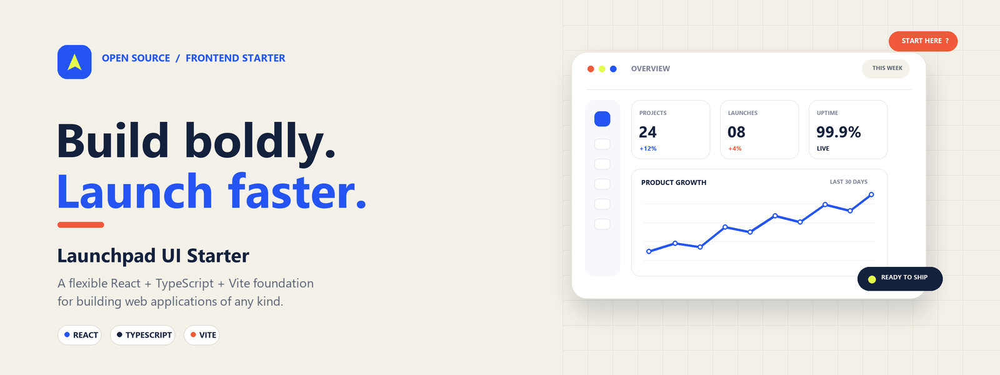

# Launchpad UI Starter



A flexible React + TypeScript + Vite starter for building web applications of any kind, from simple websites and interactive tools to full-scale products.

## Why this name?

`Launchpad UI Starter` keeps the project clear, professional, and memorable. It communicates speed, launch readiness, and UI polish without sounding generic, which makes it a strong choice for a portfolio site or open-source showcase.

## Features

- React 19 + TypeScript
- Vite 7 for fast local development
- Tailwind CSS for styling
- Dark mode support
- Protected route flow with mock authentication
- Socket.io setup pattern for real-time apps
- Clean folder structure for scalable product frontends

## Quick start

1. Install dependencies:
   ```bash
   npm install
   ```
2. Start the dev server:
   ```bash
   npm run dev
   ```
3. Create a `.env` file from `.env.example` when needed:
   ```bash
   cp .env.example .env
   ```

## Environment variables

```env
VITE_SOCKET_URL=http://localhost:3000
VITE_APP_TYPE=development
```

## Built for

Use this starter as a foundation for websites, internal tools, dashboards, SaaS products, or other React applications. Its structure is intentionally adaptable rather than tied to a specific product category.

## Project structure

```bash
src/
  components/
  context/
  pages/
  utilities/
  App.tsx
  main.tsx
  index.css
```

## Scripts

```bash
npm run dev
npm run build
npm run lint
npm run format
```

## License

MIT
